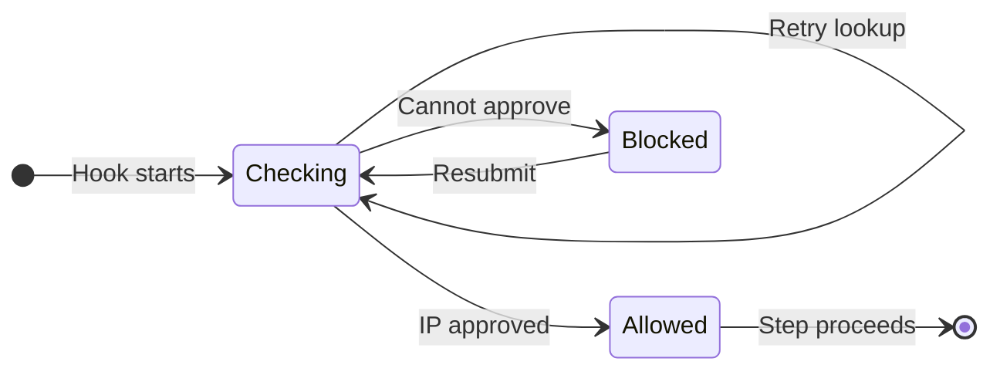

# UX: Recover from transient VPN IP lookup failures

## 1. Why

A single failed public-IP lookup blocks Claude even when the VPN is connected. Alex requested the proposed retries, independent fallback and diagnostic logging in the Claude plugin, followed by local installation.

## 2. Surfaces

| Surface | Change | When visible |
| --- | --- | --- |
| Existing Claude hook error | Final lookup failure includes attempt count and diagnostics path | Verification cannot succeed |
| Local diagnostics file | Timestamp, endpoint, attempt, elapsed seconds, curl exit code and error | Failure, recovery or mismatch |

No screen or layout changes; a visual prototype is not applicable to command hooks.

## 3. States

| State | Trigger | Visible result | Recovery |
| --- | --- | --- | --- |
| Checking | Supported hook starts | Nothing | Wait |
| Retrying | Lookup fails or returns malformed IPv4 | Nothing | Wait for another endpoint |
| Allowed | Fresh IPv4 matches allowlist | Nothing; step proceeds | None |
| Mismatch | Fresh valid IPv4 is not allowed | Existing IP mismatch error | Restore VPN or correct allowlist, then resubmit |
| Unavailable | Attempts or deadline exhausted | Lookup error with diagnostics path | Inspect log, restore connectivity, then resubmit |
| Missing settings | Allowlist cannot be read | Existing settings error | Repair allowlist, then resubmit |

## 4. Transitions

| From | Event | To | Visible result |
| --- | --- | --- | --- |
| Checking | Lookup fails; attempts/time remain, automatically | Checking | Nothing |
| Checking | Lookup returns approved IP, automatically | Allowed | Step proceeds |
| Checking | Lookup returns unapproved valid IP, automatically | Blocked | Existing mismatch explanation |
| Checking | Attempts/time exhausted or settings missing, automatically | Blocked | Specific failure explanation |
| Blocked | User fixes connection/settings and resubmits | Checking | Fresh verification |

## 5. Quiet states

Successful checks and retries produce no stdout or stderr. Recovered failures are logged locally. No conversation content enters the diagnostics.

## 6. Time and limits

| Limit | Reason |
| --- | --- |
| Three attempts: ipify, Amazon, ipify | An independent fallback and one fresh retry without a long hook delay |
| Three seconds per attempt; two seconds connecting | Reserve time for fallback during a slow endpoint |
| Ten-second wall-clock deadline, checked before each request and accepting its result | Bound the entire verification; each request is capped by time remaining |
| No cached approvals | A previous VPN route cannot authorize the current step |
| No retries after a valid mismatch | A second service must not override observed unapproved egress |

## 7. Wording

- Missing settings: "VPN Guard: cannot read settings: {path}; request blocked."
- Mismatch: "VPN Guard: public IP {ip} is not allowed; request blocked. Settings: {path}"
- Unavailable: "VPN Guard: public IP lookup failed after {attempts} attempts; request blocked. Diagnostics: {path}"

## 8. Edges

Empty or malformed replies retry; no response can allow a step without an exact allowlist match. Concurrent hooks keep separate temporary error files. A failed log write cannot allow or block a request by itself. Every invocation reads settings and performs fresh requests. Unavailable or empty allowlists cannot authorize work.

## 9. Excluded

No IPv6 extension, periodic session stopping or hook changes: this patch improves the plugin's existing IPv4 gates. No permission/trust changes, background daemon or automatic model resumption.

## 10. Decisions

Use the AWS HTTPS endpoint as an independent fallback after ipify fails. Keep the existing immediate mismatch refusal. Diagnostics use the standard local state directory, with an optional explicit path, and log only failures, recovery and mismatch to avoid a line per successful tool batch.

## 11. Requirements

Retries, independent fallback and diagnostic logging are covered by sections 3-8. Install through Claude Code's plugin CLI and verify installed bytes, hooks and a real allowed-IP invocation. Loading hooks into a running Claude session requires a fresh session; do not restart active work.
